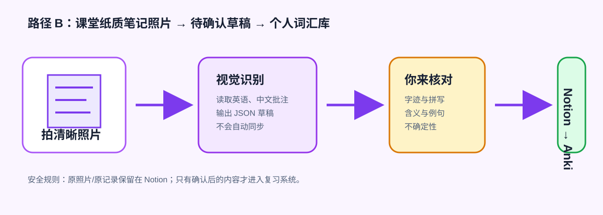

# 定制你的个人词汇库

> 让每一个单词都带着你的理解、经历和联想，真正进入长期记忆。

这不是把一份通用单词表机械地搬进记忆软件，而是建立一套由你亲自编码的个人词典。词条保留真实遇见它的语境、你的中文理解、例句、故事和联想；整理时再核对自然用法、chunk 与场景之间的关系。卡片让你从具体英文情境主动提取自然表达，概念图帮助辨认词或 chunk 所指的实体，独立发音帮助练习词、搭配和整句。方法设计依据及其适用边界见[个人词汇库方法与理论依据](docs/personal-vocabulary-method.md)。

Notion 是灵活的采集与整理中心，方便你在电脑、平板和手机上随时记录并同步；Anki 是长期记忆与本地存储中心，利用间隔重复把零散输入转化为能够主动提取的词汇。Codex Skill 负责连接两端：发现新增内容、修正不自然表达、制作多模态卡片、避免重复，并在同步后核对 Notion 与 Anki 是否一致。

它支持从零开始：没有 Notion 页面时创建学习主页和词汇库；没有 Anki 时可通过 Windows Package Manager 安装；没有牌组或卡片模型时自动创建。你只需要持续记录，系统负责把记录整理成可复习、可追踪、可迁移的个人词汇资产。

项目名称：**Notion → Anki Vocabulary Skill**

## 支持范围

| 项目 | 支持情况 |
|---|---|
| Codex Desktop / CLI | 支持 |
| Windows 10/11 本地运行 | 完整支持 |
| Notion 首次建页建库 | 支持，需要先连接 Notion |
| 手写英语课堂笔记照片 | 支持，先生成待人工确认草稿 |
| 自动安装 Anki | 支持，通过 `winget` |
| 安装 AnkiConnect | 半自动：打开 Anki并复制官方插件码，用户在 Anki 中确认安装 |
| macOS / Linux | Skill 指令可用；本地启动和 SAPI 音频脚本暂不支持 |
| Codex Cloud | 可整理 Notion；不能连接用户电脑上的 `127.0.0.1:8765` |

AnkiConnect 是 Anki 内运行的第三方插件，Anki 官方界面要求用户确认安装，因此这里不会绕过确认或把未知插件文件直接写入 Anki 配置目录。

## 最快安装方式

在 Codex 中调用系统自带的 `$skill-installer`：

```text
$skill-installer install from 555K-WDY/notion-anki-vocabulary, path skills/notion-anki-vocabulary
```

Skill 会在下一轮对话可用。然后说：

```text
$notion-anki-vocabulary 初始化我的词汇系统
```

也可以下载或克隆仓库后运行：

```powershell
.\install.ps1
```

## 首次运行会做什么

1. 检查运行环境和本地配置。
2. 如果 Notion 尚未连接，明确提示连接；不会索要或保存 Notion 密钥。
3. 如果没有学习页面，在用户指定的父页面下创建；未指定时创建私人顶层页面。
4. 创建“新增内容”“同步概览”和独立的“词汇整理库”。
5. 如果没有 Anki，在用户明确要求完整初始化或同意安装后执行：

   ```powershell
   .\scripts\install-prerequisites.ps1 -InstallAnki -PrepareAnkiConnect
   ```

6. Anki 打开后，进入 `工具 → 插件 → 获取插件`，粘贴剪贴板中的 `2055492159`，安装并重启 Anki。
7. 验证 AnkiConnect 后，自动创建 `Vocabulary::Active` 牌组和 `Notion Anki Vocabulary` 卡片模型。
8. 把页面 ID、数据库 ID和本机 Anki 路径写入 `%LOCALAPPDATA%\NotionAnkiVocabulary\profile.json`。

Anki 可从[官方网站](https://apps.ankiweb.net/)下载；AnkiConnect 的官方 AnkiWeb 插件码为 [`2055492159`](https://ankiweb.net/shared/info/2055492159)。

## 日常使用

```text
$notion-anki-vocabulary 检查新增内容并同步到 Anki
```

每一条新增词汇都会进入 Anki，学习分类不会取消同步资格。表达不自然时，Skill 会保留原记录、推测原意并用修正后的自然英文制卡。

普通词汇卡正面显示目标词、1–2 个场景相关 chunk 的独立读音、具体英文场景和独立回忆问题，不提前显示答案。背面先放与词或 chunk 明确对应的概念图，再给出该场景下自然、常见的口语表达与例句。词和 chunk 使用可单独播放的英音；完整表达和每条例句分别播放。虚词使用短英文触发标签和典型用法，避免套用不相关的实体图。完整规则与理论说明见[个人词汇库方法与理论依据](docs/personal-vocabulary-method.md)。

如果当前 Codex 没有图像生成能力，Skill 会为可视觉化的词义生成专属 SVG 概念提示图，不会让不同词条共用总览图。抽象虚词使用已经确认的英文触发标签，不强行配无关实体图。

## 方法与卡片规则

个人词汇库的建设理由、认知学习依据、普通词与虚词的不同卡片结构、同步核验门槛和隐私边界，集中写在[方法与理论说明](docs/personal-vocabulary-method.md)及 skill 的 [workflow contract](skills/notion-anki-vocabulary/references/workflow-contract.md)。

## 手写课堂笔记也能变成词汇库



现在不必先把纸质笔记打字。你可以把照片直接上传到 Codex 对话，或上传到 Notion 的“新增内容”再把页面链接交给 Skill。Skill 只会把可见内容整理为**待人工确认**草稿：保留原记录，并标出推测原意、置信度和不确定处。未确认的照片内容绝不会自动写入 Notion 数据库或 Anki。

在 Windows 上，也可使用内置的 `recognize-handwriting.ps1` 调用视觉服务，将 JPG/JPEG、PNG 或 WebP（最大 10MB）转为 JSON 草稿。API Key 只从当前 PowerShell 会话读取，调用设置为 `store: false`。完整步骤、审核清单与两条建库路径见：[Windows 图文教程](docs/windows-getting-started.md) 和 [手写笔记采集规范](skills/notion-anki-vocabulary/references/handwriting-capture.md)。

## 诊断

```powershell
.\skills\notion-anki-vocabulary\scripts\doctor.ps1
```

常见问题及处理方法见 [`references/troubleshooting.md`](skills/notion-anki-vocabulary/references/troubleshooting.md)。

## 测试

测试使用临时目录和模拟 AnkiConnect 服务，不接触真实牌组：

```powershell
.\tests\test-skill.ps1
```

GitHub Actions 会在每次推送后重复执行同一套测试。

## 隐私与安全

- 仓库不包含任何个人 Notion 页面 ID、访问令牌、Anki 数据或媒体。
- 本地 profile 不包含密码，只保存对象 ID、路径和牌组设置。
- 如启用了 AnkiConnect API Key，只通过当前进程的 `ANKI_CONNECT_API_KEY` 环境变量提供，不能写进 profile。
- 不会自动删除重复卡片或未迁移的 Notion 内容。
- 只有 Anki 写入和媒体核验成功后，才会把 Notion 标记为“已同步”。

## English summary

This is a Windows-first Codex skill that bootstraps and runs a Notion-to-Anki vocabulary workflow. It creates missing Notion and Anki structures, corrects natural English, builds multimodal cards, deduplicates notes, verifies media, and writes results back to Notion. Personal IDs and credentials are never committed.

## License

MIT
